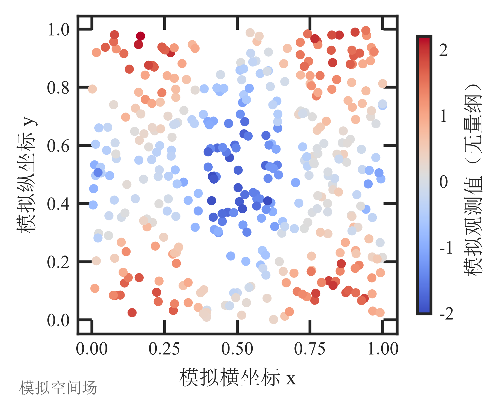
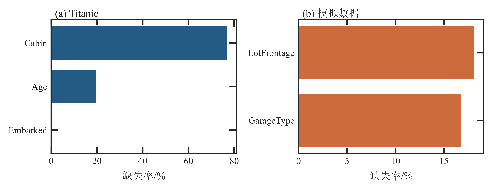
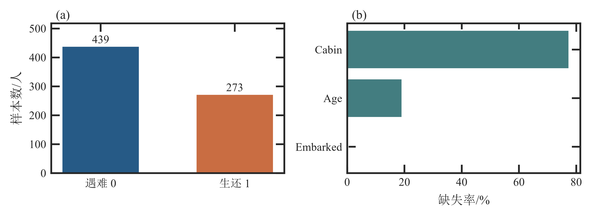
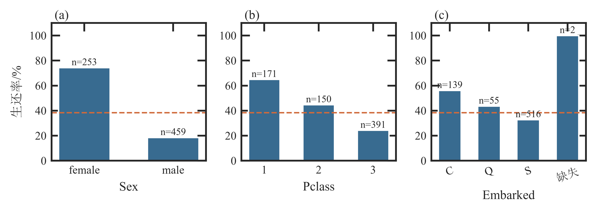
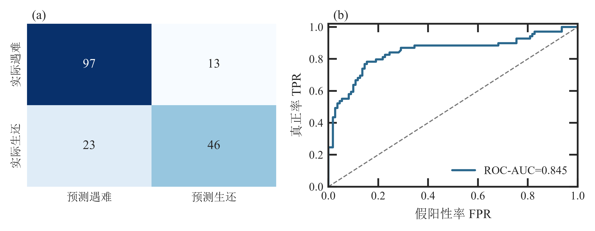
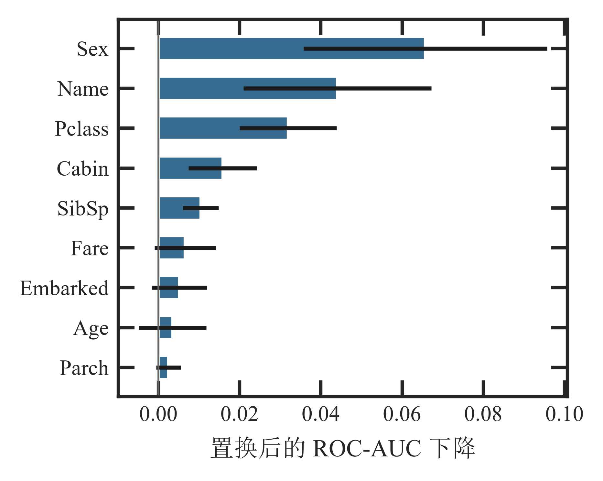
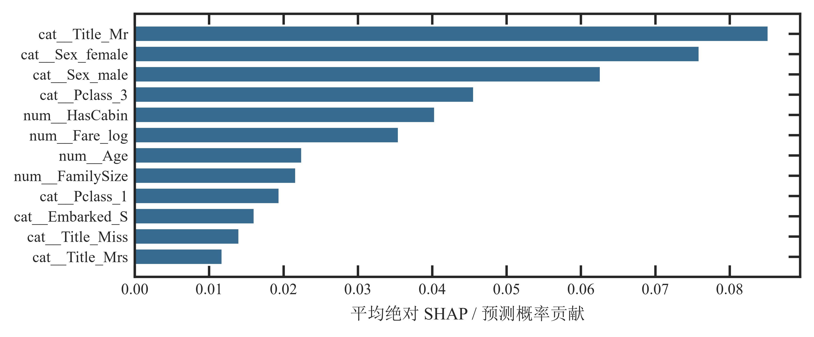
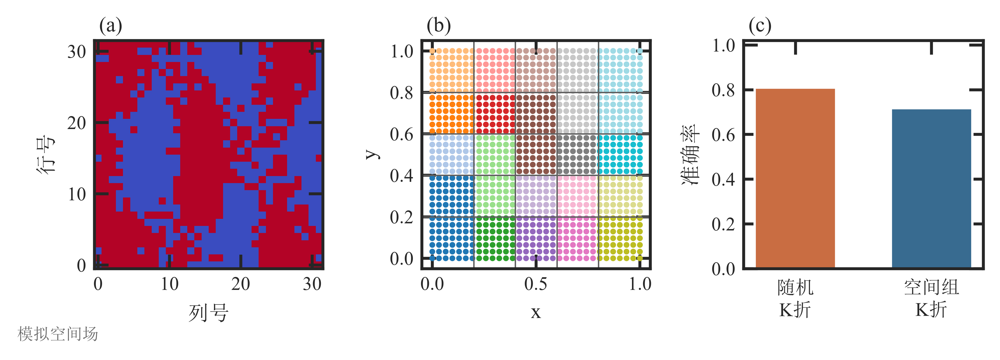

# cn-journal-figs

中文核心期刊制图规范技能（WorkBuddy Skill）——让 matplotlib 出图直接达到《地理学报》《地理研究》级投稿标准，不走"先出图再返工"的弯路。

## 功能

- **期刊级初始化**：中文宋体（SimSun）+ Times New Roman 逐字形回退、刻度朝内四周齐全、图内无标题、字号 9/8 pt 全局统一、`pdf.fonttype=42` 防 Type3；
- **组合图版式**：4 幅 = 2×2；3 幅 = 2×2 第二行居中（面板等大、只平移不加宽）；5–6 幅 = 2 行 3 列；
- **辅助函数**：`savefig`（矢量 PDF + 600 dpi PNG 双格式落盘并行内显示）、`panel`（面板编号统一位于上方外侧左上角）、`center_bottom_left`（三图居中版式）、`save_table`（`utf-8-sig` CSV）；
- **代码配方**：共享坐标轴、双 y 轴着色、共用 colorbar（`vmin/vmax` 全局统一）、线型+标记+颜色三重编码（黑白打印可辨）、显著性 bracket、图注四段式模板、地图合规红线（审图号、南海诸岛完整表示）；
- **图件自检脚本**：一键检查 PDF 字体嵌入与 Type3、PNG 物理尺寸（半栏 8 cm / 通栏 15 cm）与 dpi、彩色类别灰度可辨性。

## 安装

将整个 `cn-journal-figs/` 文件夹复制到 WorkBuddy 技能目录：

```
# 用户级（推荐，跨项目可用）
~/.workbuddy/skills/cn-journal-figs/
```

重启 WorkBuddy 会话后即可。对话中出现"画图""出图""期刊图""组合图""审图号"等意图时自动触发。

## 使用

### 1. 初始化单元

将 `assets/journal_init.py` 整段复制到 notebook 首个代码单元（**顺序铁律**：`sns.set_theme()` 在前、字体设置在后，否则字体被覆盖）。

### 2. 三幅子图的居中版式

```python
fig, axes = plt.subplots(2, 2, figsize=(FULL_W, 11 * CM))
# 绘制 (a)(b)(c) ...
fig.tight_layout()               # ★ 必须先 tight_layout
center_bottom_left(fig, axes)    # 再删空格并水平居中（tight_layout 会撤销 set_position）
panel(axes[0, 0], "(a)"); panel(axes[0, 1], "(b)"); panel(axes[1, 0], "(c)")
savefig(fig, "fig04_layout.png")
```

### 3. 图件自检

```bash
python scripts/check_figure.py figures/fig.pdf figures/fig.png
# 或整目录递归检查
python scripts/check_figure.py figures/
```

### 4. 图注四段式

```markdown
> **图4**　(a) 性别、(b) 舱位等级分组下的生还率，虚线为整体基准 38.4%，
> 误差棒为 95% 置信区间。Sex 组间差异最大。
>
> **Fig. 4**  Survival rate by (a) sex, (b) passenger class ...
```

## 出图示例（examples/）

以下 15 幅图均由本技能工作流产出并通过 `check_figure.py` 全项自检（PDF 内嵌 SimSun + TimesNewRomanPSMT、无 Type3；PNG 600 dpi、半栏 8 cm / 通栏 15 cm；彩色类别灰度可辨）。每幅同时提供矢量 PDF（投稿）与 600 dpi PNG（校对），体现双格式导出约定。

| 示例 | 说明 |
|---|---|
|  | 空间依赖示意图（组合图版式） |
|  | 缺失值模式图 |
|  | 目标变量分布与缺失 |
|  | 分类因子 EDA（多面板等大） |
|  | 混淆矩阵 + ROC 组合图 |
|  | 置换重要性条形图 |
|  | SHAP 蜂群图（字号重设后符合规范） |
|  | 空间分块交叉验证示意 |

完整清单见 `examples/` 目录（15 幅 × PNG + PDF 双格式）。

## 目录结构

```
cn-journal-figs/
├── SKILL.md                      # 技能入口：触发条件 + 五步工作流 + 陷阱速记
├── assets/journal_init.py        # 初始化单元（rcParams + 4 个辅助函数）
├── references/figure_spec.md     # 制图规范全文（12 节 + 投稿前检查清单）
├── references/layout_recipes.md  # 组合图版式与常用图元代码配方
├── scripts/check_figure.py       # 图件自检脚本（PDF 字体 / PNG 尺寸 / 灰度可辨性）
└── examples/                     # 15 幅规范出图示例（PNG + PDF 双格式，全部通过自检）
```

## 适用范围

《地理学报》《地理研究》《地理科学》《地理科学进展》《遥感学报》《测绘学报》《资源科学》《生态学报》等中文核心期刊，以及研究生课程、学位论文的 matplotlib 出图。各刊《稿约》细节略有差异，投稿前以目标期刊最新要求为准。

地图类图件须遵守《地图管理条例》：底图使用自然资源部标准地图服务系统（bzdt.ch.mnr.gov.cn），中国全图完整表示南海诸岛与台湾岛，标注审图号。

## License

MIT
